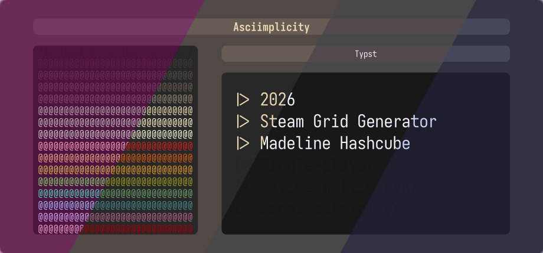

# Asciimplicity



Asciimplicity is a Programmatically generated set of Steam Grids made from a simple `.yaml` file.

## Build Instructions

Requirements:
- Typst Compiler
- Nushell (to run the build script)
- [Iosevka Hashcube](https://tangled.org/did:plc:efquyxtdunysezeo27wkrw5l)

```sh
./build (manifest) (scheme) (font)
```

- `manifest` is the name of the grid to generate. It defaults to `@all`, which builds all manifests. Manifests can be found in [./manifests](./manifests)
- `scheme` is the Base16/Base24 scheme to use when generating. It defaults to `@all`, which builds all schemes. Schemes can be found in [./schemes](./schemes)
- `font` is the name of the font you wish to use when generating grids. It defaults to `Iosevka Hashcube` which is my specific flavor of [Iosevka](https://typeof.net/Iosevka/) 

You may also put `scheme` and `font` in a `custom.yaml` file with the keys `scheme` and `font` respectively.
The values in this file will override arguments passed in to `./build`.

> [!WARNING]
> Asciimplicity is specifically made for Iosevka Hashcube (and by extension Iosevka and derivatives of Iosevka)
> and more generally monospace fonts. If your specific font does not work, please do not make an issue on this repo, I will likely not fix it

## FAQ

### What is this?

Asciimplicity (now called [Asciimplicity Legacy](https://www.steamgriddb.com/collection/18465))
is a collection of simplistic Steam Grids that I made with ascii. These kinda sucked.
Not the grids themselves, some of them are kinda good, but rather the way I had been making them.
I was using GOOGLE SLIDES and doing a lot of things manually. This is why the last one was posted
almost a year ago at the time of writing this; it just really sucked to do.

Recently though, I got reminded of the project and thought "I can do this way better." So I did.

### Why Base16/Base24

Well, it wasn't my first choice. Originally, this project used the Catppuccin Typst module.
Unfortunately, I stopped using Catppuccin in favor of a custom Base24 theme I made called Lavense.
So, I ported this project to Base16/Base24 using [`based-schemes`](https://typst.app/universe/package/based-schemes).
Which I created specifically for Asciimplicity.

### Why Typst?

I chose Typst for a few main reasons.

1. It has a Catppuccin Module (which I no longer use)
2. It's open source
3. I'm extremely comfortable working in it
4. It generates images
5. It has YAML support

### Why YAML?

It has easy multiline strings and Typst supports it

### How is this easier/better than doing things manually?

Well, for starters, this is fully open-source. fully cutting out Google as the middle man.
Second, everything is mostly automatic, the only thing that is manual is putting in some info and making the drawing.
Lastly, and this is the coolest thing by far, the Ascii art is CODE! This is the example drawing.

```typst
for color in (
  palette.base00, palette.base01, palette.base02, palette.base03,
  palette.base04, palette.base05, palette.base06, palette.base07,
  palette.base08, palette.base09, palette.base0A, palette.base0B,
  palette.base0C, palette.base0D, palette.base0E, palette.base0F
) { for _ in range(30) { text(fill: color.rgb.full)[@] }; [\ ] }
```

### Can you add `X` Game?

I might add it. However, through the power of open-source, YOU HAVE THE POWER (to go do it yourself)!!

### Can I add a colorscheme?

Yes! Add a PR and I'll add it.
